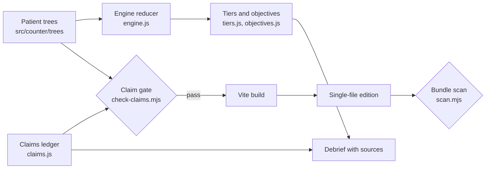

# Counter Intelligence

An offline, authored branching-dialogue game where pharmacy staff practice vaccine conversations with five fictional patients, with every clinical fact tied to a cited CDC claim that the build refuses to ship unreviewed.

**Case page:** https://kvmadden.com/projects/counter-intelligence-sim/

## Clinical claim gate

There is no LLM in this project, no free-text input and no network access. Every line the player can say is written in advance. This is a training prototype, not medical advice.

**How a claim enters the ledger.** Each fact a player can state is an entry in `src/counter/claims.js`. A staff line that states a fact cites the claim by id. To add one, an author writes the claim text, names the public-health page it comes from (organization, page title, https URL, access date), reads the claim against that page, and adds a review stamp (`reviewedBy`, `reviewedOn`). Claims that track guidance that changes often are marked `volatile` so they get re-checked each season.

One real entry:

```js
"flu-two-weeks": {
  text: "It takes about two weeks after a flu vaccine for protection to develop.",
  protects: true,
  source: { org: "CDC", title: "Key Facts About Seasonal Flu Vaccine",
            url: "https://www.cdc.gov/flu/vaccines/keyfacts.html", accessed: "2026-09-15" },
  reviewedBy: "Kevin Madden, PharmD",
  reviewedOn: "2026-09-15",
}
```

**Disclosure about the review stamps.** The stamps are the author's own. I am a pharmacist, I read each claim against its cited page and stamped it myself. No second reviewer, clinical committee or outside body has validated this content, and it should not be described as clinician-validated.

**The gate.** `scripts/check-claims.mjs` runs first in `npm run build` and fails the build when:

- a claim has no organization, title or access date (unsourced), or its URL is not an https page on a US government or listed public-health host (untrusted source);
- a claim has no review stamp, or the stamp is dated before the source was accessed (unreviewed);
- a staff line cites a claim id the ledger does not hold;
- a staff line reads as a health fact (a heuristic over health words plus fact or duration markers) but cites nothing;
- an agency name (CDC, FDA and so on) appears anywhere except a staff line that cites one of that agency's pages.

`node scripts/check-claims.mjs --self-test` plants each of these problems and confirms the gate catches it.

I ran it on 2026-10-30 by adding two temporary claims to the ledger, one with a source but no review stamp and one with a stamp but an empty organization and a non-public-health URL. This is the output of `node scripts/check-claims.mjs` (exit code 1):

```
claims: 26 claims, 5 trees, 193 staff lines checked
  RED claim temp-unreviewed :: unreviewed claim :: needs Kevin's review stamp (reviewedBy and reviewedOn)
  RED claim temp-unsourced :: unsourced claim :: the source needs an organisation and a page title
  RED claim temp-unsourced :: untrusted source :: the source must be an https page on a public-health host, got https://example.com/flu-facts
```

`npm run build` stopped at the same step with exit code 1, so no bundle was produced. The temporary claims were then removed. With the real ledger the gate reports `claims: 24 claims, 5 trees, 193 staff lines checked` and `GREEN`.

The gate checks that a claim is sourced, from a permitted host and stamped. It does not check that the claim text matches the page. That comparison is the human review.

## Problem

Retail pharmacy staff have many short, high-stakes conversations: a vaccine recommendation to someone in a rush, a worry about side effects, a person who has skipped a shot for twelve years. Most training for these is a slide deck or a script. Staff rarely get a safe place to try three approaches on the same hesitant patient and see what happens, and a training tool that gets a clinical fact wrong does harm. This project tests whether the facts can be made checkable by construction.

## How it works



- **Conversation engine.** Each patient is a data-only tree. A node holds the patient's line and the player's choices (ASK, OFFER, SIT WITH IT, CLOSE). A choice can set flags, carry earlier choices into later replies and branch on them. `src/counter/engine.js` is a small reducer that runs any tree and never names a patient or a line. Tests bind it to fixture trees to prove the reducer apart from any script.
- **Scoring.** A run ends in a named ending and a ranked tier (`src/counter/tiers.js`). The tier weighs the outcome and how the player got there, using two method signals every tree sets the same way: *heard* (the player asked about or made room for the patient's concern) and *permission* (the player asked before sharing information).
- **Objectives.** Higher levels (Agent, Secret Agent, 00 Agent) add objectives to the same conversation. They read OBSERVED or NOT OBSERVED about what the staff member did, never about what was extracted from the patient.
- **Debrief.** Shows what the player said, what moved the patient, which signals were hit, and the cited source behind every fact used, plus a discussion question for team play.
- **Bundle scan.** `scripts/scan.mjs` inspects the built bundle and fails on any network reference, storage use, vaccine brand name or banned name, and proves itself red on planted violations before running for real. The standalone file makes no network, analytics, storage or API request.

## Evidence

- **233 unit tests** (Vitest, run 2026-11-03; see Run locally) over the engine, trees, tiers, objectives, claims gate and scanner.
- **Whole-tree property tests.** Two ranking rules are checked over every path of every tree: a pushed yes never outranks a respectful not-today, and pushing after a no caps the run at the bottom rung.
- **Gate self-tests.** The claim gate and the scanner each plant violations and must go red before a green result counts.
- **Browser tests.** Playwright specs cover six phone and desktop viewports. They are part of `npm run gate` and need browsers installed; they were not part of the 231 count.
- No user studies, no measurements of learning outcomes.

## Design decisions and tradeoffs

- **Respectful refusal outranks pressured agreement.** In `src/counter/tiers.js`, any run that pushed the patient lands below a clean "not today", and pushing after a no is the bottom rung whatever the outcome. A booked or completed vaccination reached under pressure scores worse than a patient who declined and was treated well. The tradeoff is that the game can rank a vaccination below a refusal, and it says why in the debrief. Tests enforce this over every path.
- **Authored, not generated.** No model means no invented clinical facts and a fully inspectable script. The cost is five patients and a finite number of branches. A generative version would need the same ledger, the same scoring rules and automated evals of its own.
- **A heuristic backstop on the gate.** Requiring a citation only where an author remembers to add one would fail open, so the gate also flags fact-shaped staff lines with no citation. It is a pattern match and will miss some phrasings and flag some harmless lines.
- **No free-text entry.** Four moves per turn means nobody can type patient information into it and every state is reachable by tests.
- **Fail-closed build.** The claim gate runs before the bundler, so an unreviewed claim cannot ship.

## Limits

- Not medical advice. Facts stay at conversation level, and guidance changes; claims marked `volatile` need a re-check each season, and every claim was last read against its source in September 2026.
- Review is a single pharmacist's, the author's. There is no independent clinical review.
- The gate verifies provenance and stamps, not the correctness of the claim text.
- Five patients, one pharmacy setting, English only.
- Not validated as staff training. No evidence yet that it changes behavior.
- No persistence, accounts or analytics.

## Run locally

```
npm install
npm run dev          # dev server
npm run build        # claims gate, build, single-file edition, bundle scan
npm test             # unit tests
npm run test:browser # Playwright (run `npx playwright install` first)
npm run gate         # the full gate: all of the above plus every browser viewport
```

`npm run build` also writes `dist/counter-intelligence.html`, a standalone offline edition with fonts and art embedded. No environment variables or API keys are needed; see `.env.example`. Stack: React 18, Vite 7, Three.js, Vitest, Playwright, locally bundled OFL fonts.

## Development history

Built September to October 2026 over 122 commits in a private repository. The full history includes personal notes and private configuration, so this repository is a cleaned public snapshot. This README and the claim-gate demonstration were written for this release in October 2026.

## License

MIT, Kevin Madden, 2026. See `LICENSE`. All patients, dialogue and scenarios are fictional. The pharmacy is a generic retail counter, and patient faces and the counter scene are generated images of nobody real (prompts in `docs/assets/`).

---

## Below the fold: the briefing

*Your cover is a name tag and a steady smile. The mission: a stranger at the counter, one vaccine on the shelf, and no pressure allowed.*

You play pharmacy staff. A patient files in, guarded and a little late for something. You have four moves: **ASK** what is on their mind, **OFFER** what you know, **SIT WITH IT** while they think, or **CLOSE** the file. Push, and the file goes cold. Listen first, accept a "not today" with a straight face, and the patient might tell everyone about you on the way out.

Each patient is a case file with a codename difficulty: **Agent** for the warm-up, **Secret Agent** for a patient with a reason, **00 Agent** for the one who has been saying no since before you got your license. Every ending has a name. Some are hard to find. Rank at the debrief, and take the discussion question back to the team.

The counter is low-poly, the fonts are a little too dramatic, and the whole thing runs offline in a single file. Good luck, agent.
