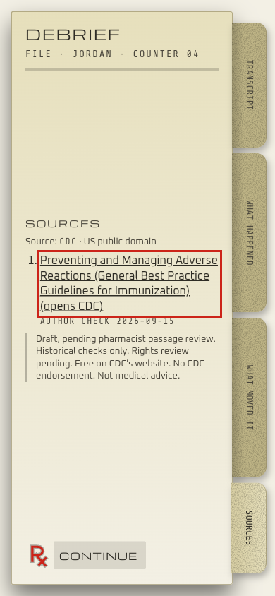

# Counter Intelligence

**Hard question: does every factual claim in the dialogue have public evidence behind it, and does every branch reward a respectful conversation over pressure?**

**Short answer:** the respect half holds. All 37,452 possible playthroughs rank pressure below a respectful "not today". The evidence half is partly proven. Kevin Madden, PharmD reviewed every claim on 2026-11-01. 15 of the 24 health claims are approved on their exact CDC passage and every line that uses them. The other 9 are rewrites, two new claims and one reworded line, each quoting a CDC page fetched that day, and they stay marked pending until he reviews them.

Counter Intelligence is a short, offline game for practicing vaccine conversations at a pharmacy counter. You play the pharmacist with five fictional patients. Each turn you pick Ask, Offer, Sit with it or Close. At the end, a debrief explains what happened, how pressure affected your result, and links to the CDC page behind every fact you used. There is no free text and no generated dialogue. Every line was written in advance.



## How we test it

| Question | How we test it | Result | Limit |
| --- | --- | --- | --- |
| Does the source actually support each claim? | A [claim support sheet](docs/claims/CLAIM-SUPPORT-SHEET.md) puts each claim next to the exact CDC passage, the game lines that use it and the link. Kevin approves or flags each one, and his decisions are recorded in [support-reviews.json](docs/claims/support-reviews.json). | 15 of 24 approved. 9 pending his second look. Supported out of decided is 15 of 15. | Approval is bound to the exact claim, quote and lines, so any edit returns a claim to pending. No second independent reviewer. |
| Does the game reward respect over pressure? | Walk every possible path through all five conversations and check the ranking rule on each. Two broken versions of the rule must fail. | 37,452 paths, 0 violations. Both broken controls fail (6,190 and 4,710 rule errors). | Proves the authored rules hold. Says nothing about how real people talk. |
| Would the build notice a new fact with no citation? | A simple pattern check run on 20 held-out lines, half factual and half ordinary talk. | Caught 2 of 10 factual lines. 3 false alarms out of 10 ordinary lines. | Weak. Line labels are AI drafts awaiting Kevin's review. The test set is public, so it is a fixed benchmark, not a blind test. |
| Can a player understand the ranking and find a source? | A [three-player pilot](docs/PILOT.md) with paired runs. | Not run yet. | No usability claim is made. |

Each result is reported on its own. There is no combined score. Full reports, intervals and every error are in [docs/proof](docs/proof/README.md).

## What the player sees

- Every fact the player used appears on the debrief's Sources tab as a link to the CDC page it came from. Links open only when the player selects them.
- Each source on the Sources tab shows whether Kevin approved it or its review is pending. The tab says the facts are not medical advice.
- Keyboard play works throughout, controls are at least 44 pixels, and motion respects the reduced-motion setting. Layout is checked at 390x844, 430x932 and 1440x900 in light and dark. Screenshots and a short GIF are in [docs/media](docs/media/README.md).
- The game makes no network requests on its own. No analytics, tracking or remote fonts.

## What this does not prove

This is a fictional prototype. It is not medical advice, and it has not been shown to improve counseling, vaccination rates or patient outcomes. 15 claims are approved by Kevin Madden, PharmD. The other 9 are drafts pending his review, and the game marks them that way. CDC guidance changes, and three claims are marked as likely to change each season. No second clinician has reviewed the content, and no real players have been observed.

## Try it

```sh
npm ci
npm run dev
```

Open the address Vite prints. `npm run build` also writes `dist/counter-intelligence.html`, a single file that plays with no connection. No keys or paid services are needed.

## Check it

```sh
npm test                          # unit tests
npm run build                     # claim check, build, network scan
npm run gate                      # full gate including browser tests
node scripts/evaluate-proof.mjs   # regenerate the proof report
node scripts/claim-sheet.mjs      # regenerate the claim support sheet
```

Command logs and earlier failed runs are in [VERIFICATION.md](docs/VERIFICATION.md).

## How the evidence is kept honest

- The build fails if any claim is missing a source link, a check date or a captured passage.
- A review decision is tied to a hash of the claim, the passage and every line that uses it. Change any of those and the approval no longer counts.
- An inventory of every string in the app is kept so a factual line cannot hide from review just because the pattern check missed it.
- CDC material is public and free on CDC's site. Linking to it does not imply CDC endorsement. Excerpt rights review is pending. See [CDC's use policy](https://www.cdc.gov/other/agencymaterials.html).

## Authorship

Kevin Madden designed the game, wrote the conversations and ranking rules, and is the clinical reviewer. AI coding tools helped build the code, the tests and the proof package, and proposed the draft passage mappings and test labels. See [HOW-BUILT](docs/HOW-BUILT.md). Code is MIT licensed. No employer content and no real patient information.
